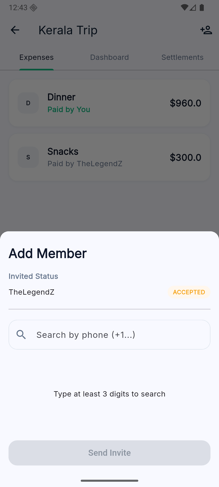
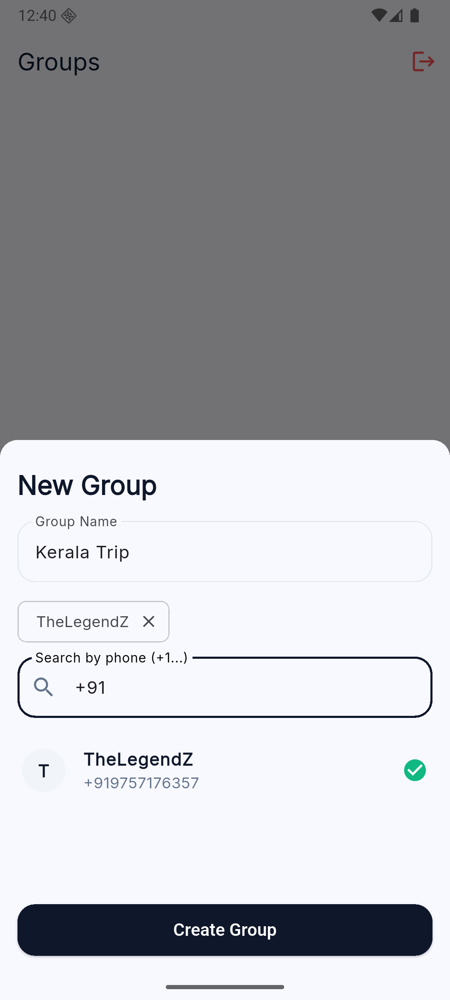
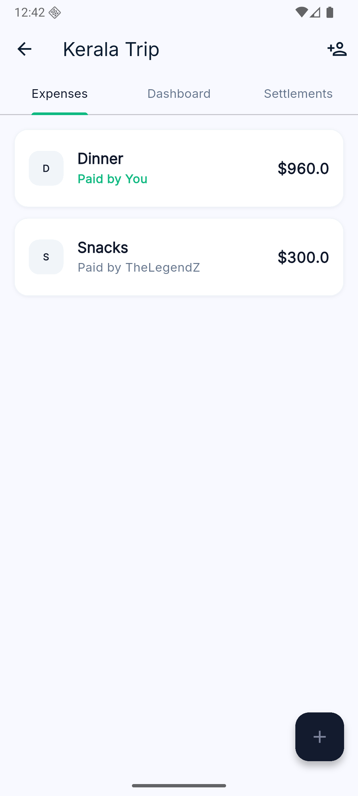
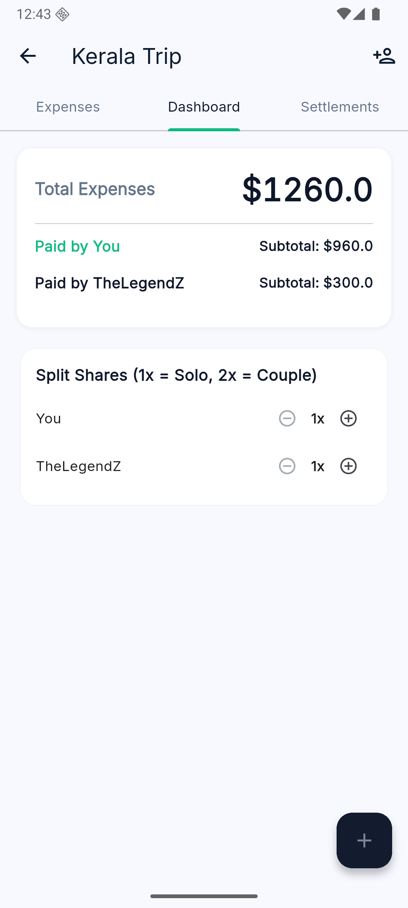
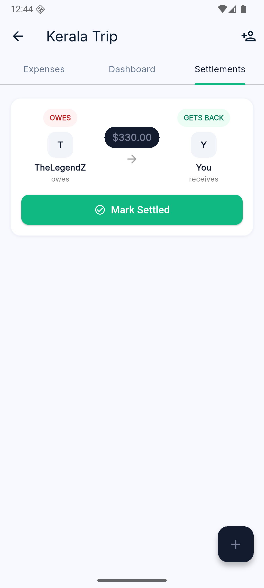

# SplitPay 🚀

### Real-Time Group Expense & Debt Simplification App

**SplitPay** is a Flutter-based mobile application designed to take the headache out of shared
expenses. Whether it's a weekend trip, a shared apartment, or a dinner out, SplitPay tracks who paid
what and uses a smart algorithm to minimize the number of transactions needed to settle up.

Built with a heavy focus on clean architecture, real-time synchronization, and robust state
management, this project serves as a comprehensive showcase of modern Flutter development.

---

## 📸 Screenshots

|                         Groups Dashboard                         |                          Creating a Group                          |                     Expense Tracking                     |
|:----------------------------------------------------------------:|:------------------------------------------------------------------:|:--------------------------------------------------------:|
|  |  |  |

|                    Financial Overview                     |                          Invite Members                          |                      Smart Settlements                      |
|:---------------------------------------------------------:|:----------------------------------------------------------------:|:-----------------------------------------------------------:|
|  |  |  |

---

## ✨ Key Features

* **Real-Time Synchronization:** Instantly reflects expense changes and invitations across all group
  members using Riverpod reactive streams and Firebase Cloud Firestore.
* **Smart Debt Simplification:** Utilizes a custom Greedy Algorithm to calculate net balances and
  minimize the total number of peer-to-peer transactions required to settle debts.
* **Weighted Headcount Shares:** Supports uneven splitting (e.g., 1x for a solo traveler, 2x for a
  couple sharing expenses) to accurately reflect complex group dynamics.
* **Robust Invitation Lifecycle:** Search for users by phone number, send invites, and handle
  acceptance statuses safely via atomic database operations.
* **Intuitive UX & UI:** Includes a custom reusable widget library, smooth modal sheets, and
  creator-verified swipe-to-delete functionality with instant "Undo" SnackBar restoration.
* **Secure by Design:** Backed by custom Firestore Security Rules enforcing strict Role-Based Access
  Control (RBAC).

---

## 🛠️ Tech Stack & Architecture

* **Framework:** Flutter & Dart
* **State Management:** Riverpod (AsyncNotifier, StreamProvider, StateProvider)
* **Backend:** Firebase (Authentication, Cloud Firestore)
* **Architecture:** Feature-First Clean Architecture

### 🏗 Architecture Deep Dive

The project is structured using a **Feature-First Clean Architecture**. This separates the app into
highly modular, scalable domains:

* `auth/`: Login, registration, and user session management.
* `groups/`: Group creation, member management, and invitation logic.
* `group_detail/`: Expense tracking, dashboard insights, and splits.
* `settlements/`: Debt calculation and transaction history.

Each feature is divided into `data`, `domain`, and `presentation` layers, ensuring business logic is
decoupled from UI and external data sources.

---

## 🧮 The Settlement Calculator (Algorithm)

The core of the app lies in the `SettlementCalculator`. Instead of forcing everyone to pay back
exactly what they owe per item (which results in a mess of transactions), the app computes the *net
balance* of every user in the group.

**How it works:**

1. Calculates total paid vs. total owed for each user based on weighted shares (`1x` solo, `2x`
   couple).
2. Separates users into "Creditors" (owed money) and "Debtors" (owe money).
3. Uses a **Greedy Algorithm** to match the largest debtor with the largest creditor, settling the
   maximum possible amount at each step until all balances are zero.

*Result: Instead of 10 people making 15 different transactions, everyone makes a maximum of 1 or 2.*
(See the *Settlements* screenshot above).

---

## 🛡️ Backend Engineering Highlights

* **Atomic Operations:** Utilizes Firestore `WriteBatch` for critical operations, such as creating a
  group and simultaneously adding the first member. This guarantees data consistency—if one step
  fails, the entire operation rolls back.
* **Cascading Deletes:** Safely deletes group data without leaving orphaned documents in the
  database.
* **Security Rules:** Firestore rules are written to ensure users can only read/write data for
  groups they are a member of, preventing unauthorized access.

---

## 🧪 Testing

* **Unit Tests:** Comprehensive unit tests are written for the `SettlementCalculator` to ensure the
  math behind the Greedy Algorithm is flawless across various edge cases (zero balances, uneven
  splits, multiple creditors).
* **Widget Testing:** (Optional: Add if you have widget tests for the custom UI components).

---

## 🚀 Getting Started

To run this project locally, follow these steps:

### Prerequisites

* Flutter SDK (v3.10+)
* Firebase account and a configured project
* FlutterFire CLI

### Installation

1. **Clone the repository:**
   ```bash
   git clone https://github.com/TheLegendZK/SplitPay.git
   cd splitpay
   ```

2. Install dependencies:
    ```bash
    flutter pub get
    ```

3. Configure Firebase:
    - Create a new project in the Firebase Console.
    - Enable Authentication (Phone or Email/Password) and Cloud Firestore.
    - Run the following command to configure FlutterFire:
      ```bash
      flutterfire configure
      ```
    - Copy your Firestore Security Rules from firestore.rules and deploy them in the Firebase
      console.

4. Run the app:
    ```bash
    flutter run
    ```

### Running Tests

To execute the unit and widget tests, run:

```sh
flutter test
```

## 🤝 Contributing

Contributions, issues, and feature requests are welcome! Feel free to check
the [issues page](https://github.com/TheLegendZK/SplitPay/issues).l̥

## 👨‍💻 Author

### Kamil Mohd Zahid Mohd Hamid

- GitHub: [@TheLegendZK](https://github.com/TheLegendZK)
- LinkedIn: [linkedin.com/in/thelegendz](https://www.linkedin.com/in/thelegendz/)
- Portfolio: [thelegendzk.github.io/portfolio](https://thelegendzk.github.io/portfolio/)

***If you like this project, feel free to give it a ⭐️!***
